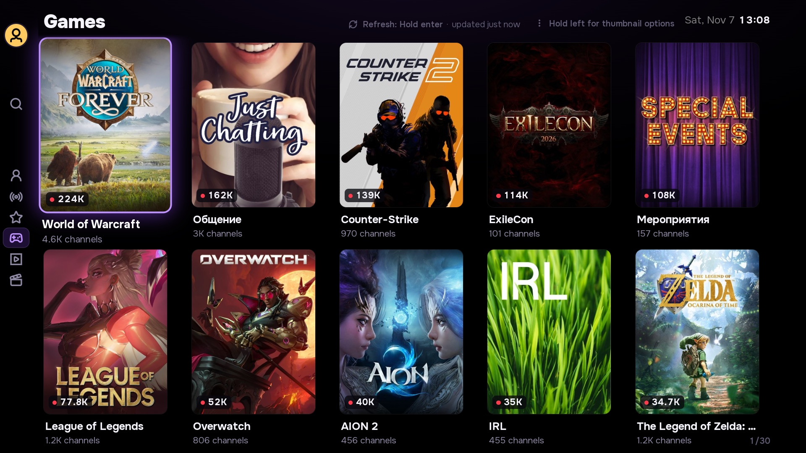
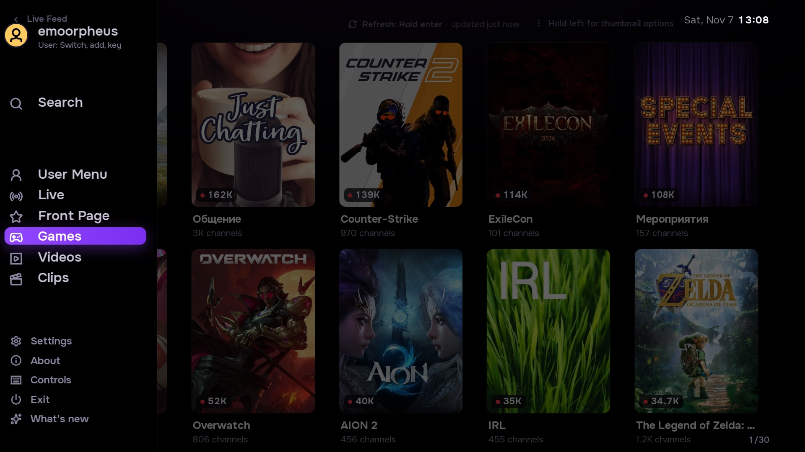
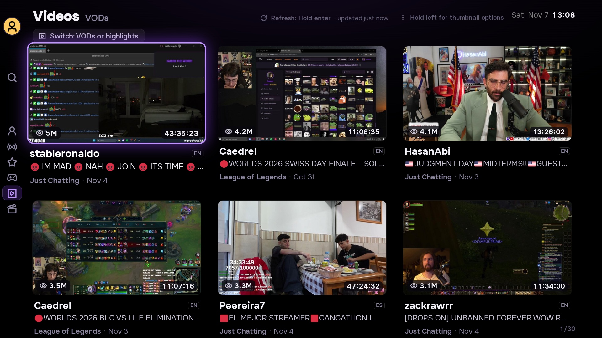
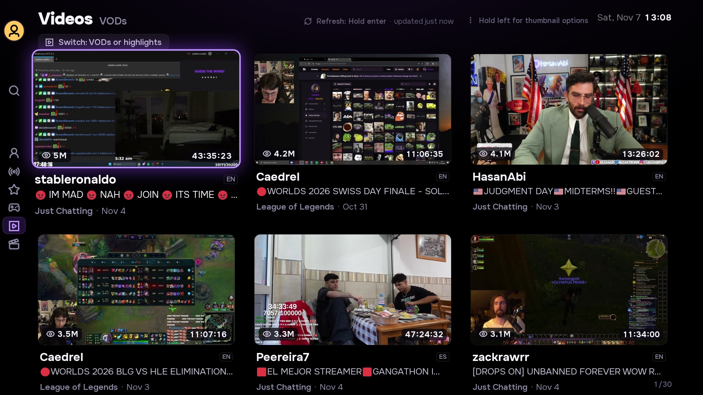
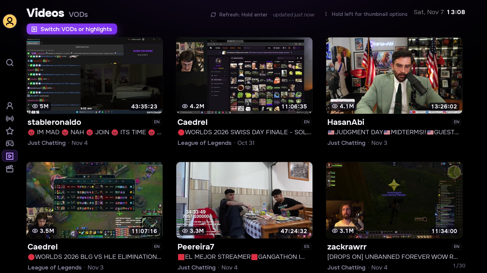
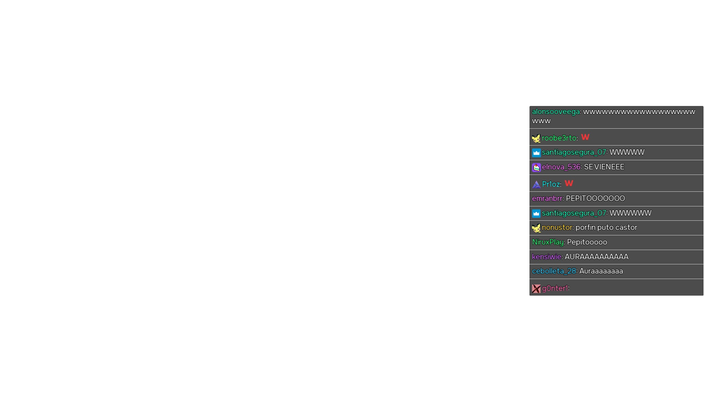
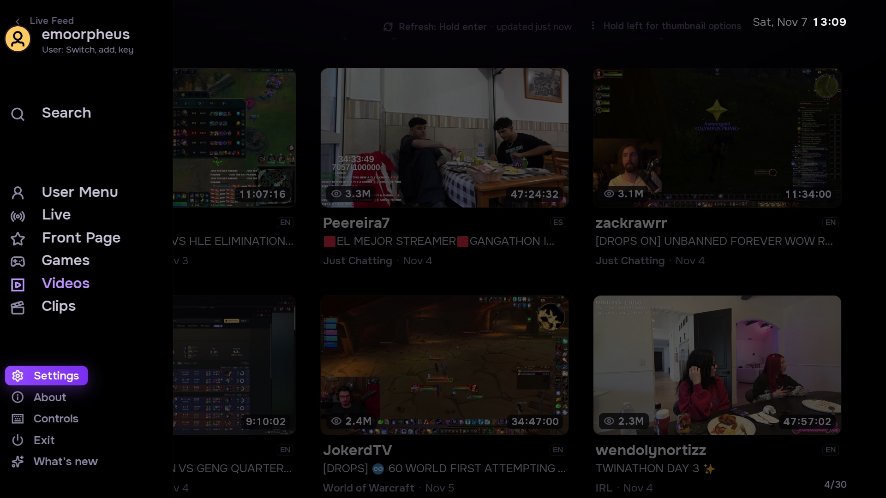
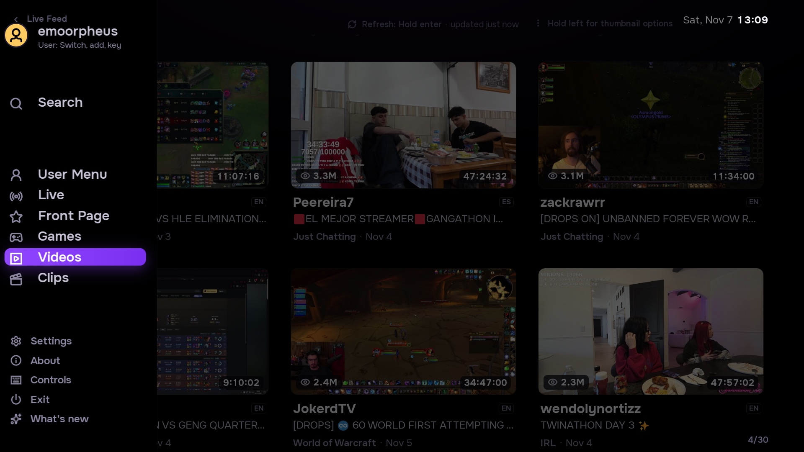
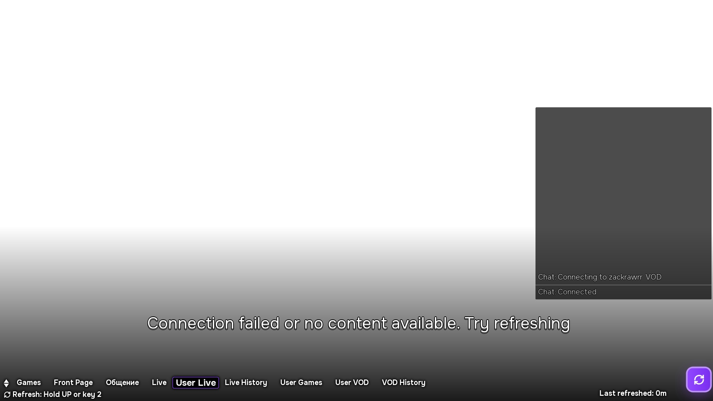

<p align="center">
  
</p>

<h1 align="center">Twitch Next-Gen for LG webOS</h1>

<p align="center">
  <b>Modern, lightweight, ad-free standalone Twitch client for LG webOS Smart TVs</b><br>
  Featuring pitch-preserving 0.25–2× VOD speed, Next-Gen Onest typography, 52.4 FPS smooth remote navigation, and True Black OLED mode.
</p>

<p align="center">
  <a href="https://github.com/emoorpheus/TwitchNG/releases/latest"></a>
  
  <a href="LICENSE"></a>
  
</p>

<p align="center">
  <a href="README.ru.md"><b>🇷🇺 Читать документацию на русском языке</b></a>
</p>

---

## 🌟 Overview

**Twitch Next-Gen (Twitch NG)** is a community-driven, standalone Twitch application designed from the ground up for LG webOS Smart TVs. It installs under its own dedicated application identity (`com.twitchng.tv`), running side-by-side with the stock Twitch app without overwriting, replacing, or interfering with it.

Twitch NG bridges the gap between desktop Twitch browsing and the living room TV experience: enjoy pitch-preserving variable speed playback on VODs (from 0.25× up to 2×), a high-refresh Next-Gen UI powered by **Onest** typography and **Lucide** vector glyphs, instant 1× speed restoration without decoder stalls, and a dedicated True Black OLED presentation crafted specifically for dark-room viewing on modern OLED panels.

<p align="center">
  
  <br>
  <i>Home screen with live stream cards, rich stream metadata, Onest typography, and True Black (#000000) OLED theme</i>
</p>

---

## ✨ Features

- 🎮 **Built Around the TV Remote**: Large readable cards, prominent purple focus glows, persistent side navigation rail, and fluid remote navigation calibrated at **52.4 FPS** on live LG webOS TV hardware.
- ⚡ **Pitch-Preserving VOD Speed (0.25× – 2×)**: Bundled **STTV Speed 1.3.9** engine provides time-stretching with pitch preservation using the WSOLA algorithm across 0.25×, 0.5×, 0.75×, 1×, 1.25×, 1.5×, and 2× speeds. Speed controls appear strictly on VODs and never clutter live broadcasts.
- 🔄 **Instantaneous 1× Speed Restoration**: Zero-delay transition back to native 1× playback, eliminating the 10–24 second decoder stalls and black-screen freezes common in webOS media pipelines.
- 📈 **Dynamic Quality Step-Up**: Intelligent network recovery automatically restores high-definition stream variants after transient Wi-Fi drops once bandwidth stabilizes.
- 🌑 **True Black OLED Mode**: Replaces washed-out greys with pure `#000000` pixels across the browse interface, player controls, and start screen to eliminate panel glow and maximize contrast.
- 🎬 **Modern Player Interface (Stage 3)**:
  - Minimalist centered circular Play/Pause button with focus glow.
  - Smooth gradient progress timeline with unclipped 100% position marker.
  - Asymmetric clip-path boundary preventing progress timeline leakage to the left during rewind.
  - Multi-layer drop shadows on timecodes for crisp legibility over bright video content.
  - Glass OSD controls elevated above semi-transparent chat overlays.
- 💬 **Integrated Live Chat & Channel Context**: Real-time viewer count, broadcast uptime, language tags, category badges, and chat overlay without obstructing the action.
- 🔍 **Comprehensive Discovery**: Browse recommended rows, follow live channels, explore game categories, search channels with instant results, and browse highlights or VODs.
- 🎛️ **Dual Language Support**: Full out-of-the-box support for both **English** and **Russian**, with automatic system locale detection and manual overrides in Settings.
- 🛡️ **Zero Telemetry & Private Session**: Completely ad-free stream viewing without analytics or telemetry tracking. App data and credentials remain fully isolated on your TV.

---

## 📸 Screenshots

Screenshots demonstrate the Twitch NG 1.0.0 release interface captured directly on 1080p LG OLED TV layout. Individual stream cards, channels, and thumbnails reflect live real-time browsing content.

<table align="center" width="100%">
  <tr>
    <td width="50%" align="center"><b>Home & Live Streams</b></td>
    <td width="50%" align="center"><b>Side Navigation Drawer</b></td>
  </tr>
  <tr>
    <td align="center"></td>
    <td align="center"></td>
  </tr>
  <tr>
    <td align="center"><i>Live streams with real-time viewer badges, category tags, stream title, and uptime</i></td>
    <td align="center"><i>Quick access rail to Search, Categories, VODs, Clips, Settings, and Account</i></td>
  </tr>
  <tr>
    <td width="50%" align="center"><b>Categories & Games</b></td>
    <td width="50%" align="center"><b>Game Streams Row</b></td>
  </tr>
  <tr>
    <td align="center"></td>
    <td align="center"></td>
  </tr>
  <tr>
    <td align="center"><i>Browse games and creative categories with live viewer counters</i></td>
    <td align="center"><i>Top live broadcasts within the selected game category</i></td>
  </tr>
  <tr>
    <td width="50%" align="center"><b>Video Library (VODs)</b></td>
    <td width="50%" align="center"><b>Clips Grid</b></td>
  </tr>
  <tr>
    <td align="center"></td>
    <td align="center"></td>
  </tr>
  <tr>
    <td align="center"><i>Past broadcasts with duration pills, watch progress bars, and broadcast dates</i></td>
    <td align="center"><i>Popular clips filtered by day, week, month, or all-time highlights</i></td>
  </tr>
  <tr>
    <td width="50%" align="center"><b>Channel Search</b></td>
    <td width="50%" align="center"><b>Settings Screen</b></td>
  </tr>
  <tr>
    <td align="center"></td>
    <td align="center"></td>
  </tr>
  <tr>
    <td align="center"><i>Instant channel search with circular avatars and partner status</i></td>
    <td align="center"><i>Remote-optimized settings with purple focus rings, audio diagnostics, and language controls</i></td>
  </tr>
  <tr>
    <td width="50%" align="center"><b>What's New Dialog</b></td>
    <td width="50%" align="center"><b>Player Interface & OSD (Stage 3)</b></td>
  </tr>
  <tr>
    <td align="center"></td>
    <td align="center"></td>
  </tr>
  <tr>
    <td align="center"><i>Release changelog and feature updates directly on screen</i></td>
    <td align="center"><i>Modern Stage 3 player with centered controls, sleek progress gradient, and live chat</i></td>
  </tr>
</table>

---

## 📦 Package Selection

| Package | Supported webOS | Target Architecture | Size |
|---|---|---|---|
| **`com.twitchng.tv_1.0.0_all.ipk`** | **webOS 3.0+ \| 22+ \| 24+ \| 25+** | Universal (All webOS Smart TVs) | **~1.2 MB** *(Standalone client)* |

---

## 🚀 Installation

Ensure your TV is in **Developer Mode** or has **Root** (via [webosbrew.org](https://webosbrew.org)).

### Method 1: webOS Dev Manager (Recommended GUI)
1. Download `com.twitchng.tv_1.0.0_all.ipk` from the [Releases](https://github.com/emoorpheus/TwitchNG/releases) page.
2. Launch [webOS Dev Manager](https://github.com/webosbrew/dev-manager-desktop) on your computer.
3. Click **Install...**, select the `.ipk` file, and wait for confirmation.

### Method 2: webOS CLI (ares-cli)
```bash
ares-install -d tv com.twitchng.tv_1.0.0_all.ipk
ares-launch -d tv com.twitchng.tv
```

### Method 3: Rooted TV over SSH
```bash
scp com.twitchng.tv_1.0.0_all.ipk root@$TV_HOST:/tmp/com.twitchng.tv.ipk
ssh root@$TV_HOST 'luna-send -n 1 luna://com.webos.appInstallService/dev/install "{\"id\":\"com.twitchng.tv\",\"ipkUrl\":\"/tmp/com.twitchng.tv.ipk\",\"subscribe\":false}"'
```

*To uninstall:* `ares-install -d tv -r com.twitchng.tv`

---

## 🎮 Remote Control & Shortcuts

| Button | Action |
|---|---|
| **D-Pad (Arrows)** | Navigate stream cards, sidebar, categories, and settings with clear focus rings |
| **OK / Enter** | Open selected stream, channel, category, or toggle setting |
| **Back / Return** | Return to previous view / Open side navigation drawer / Close active dialog |
| **Up (in Player)** | Show player OSD controls, progress bar, channel info, and chat status |
| **Down (in Player)** | Dismiss player OSD / Quick access to player options |
| **Left / Right (in Player)** | Seek backwards / forwards in VODs (with instant speed resume) |
| **Play / Pause** | Toggle video playback |
| **Hold OK** | Refresh active streams row or category grid |
| **Hold Left** | Open thumbnail and grid viewing options |

---

## 🌍 Language Configuration

Twitch Next-Gen includes complete localization for both **English** and **Russian**:
- The app automatically detects your TV's system locale on initial setup.
- To switch language manually:
  1. Open the left sidebar and select **Settings** (⚙️).
  2. Navigate to **Language** (`app_lang`).
  3. Select **English [EN]** or **Русский [RU]**. The UI updates instantly.

---

## 🛠️ Building from Source

**Requirements:** Node.js 22+, npm.

```bash
# Clone the repository
git clone https://github.com/emoorpheus/TwitchNG.git
cd TwitchNG

# Run quality and hygiene checks
node tests/hygiene.mjs

# Build universal package into dist/
node build/build-app.mjs
```

The resulting package will be created at:
- `dist/com.twitchng.tv_1.0.0_all.ipk`

---

## 💡 Notes & Details

- **Independent Session**: Twitch NG maintains its own authentication tokens and local preferences separate from the stock Twitch app. You can log into your account via QR code or manual key without touching other installed apps.
- **Dedicated Application ID**: Installed as `com.twitchng.tv` — will never conflict with or replace official store applications.
- **Privacy & Safety**: Twitch NG connects directly to official Twitch GraphQL, Usher, and HLS streaming endpoints. Zero telemetry, user tracking, or third-party analytical requests.

---

## 📜 Credits & License

- Licensed under **GPL-3.0-only**. See [LICENSE](LICENSE).
- Fork and evolution of [SmartTwitchTV](https://github.com/fgl27/SmartTwitchTV) by fgl27, with enhancements by TBSniller.
- Engineering, modern Next-Gen UI overhaul, STTV Speed 1.3.9 engine, and webOS 24/25 adaptations developed in human-AI pairing by **emoorpheus** with **Anthropic Claude 3.7 / Opus 5.5**, **Google Gemini 3.8 Flash**, and **Luna 6**.
- *Disclaimer:* Twitch is a trademark of Twitch Interactive, Inc. This project is an independent community open-source initiative and is not affiliated with, endorsed by, or authorized by Twitch Interactive, Inc. or LG Electronics.
