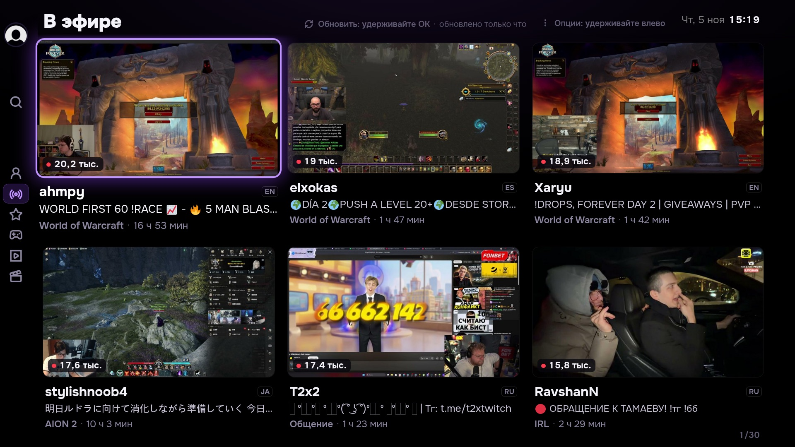
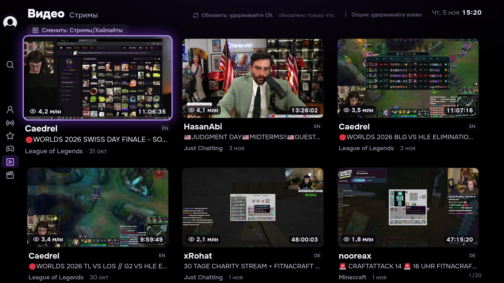
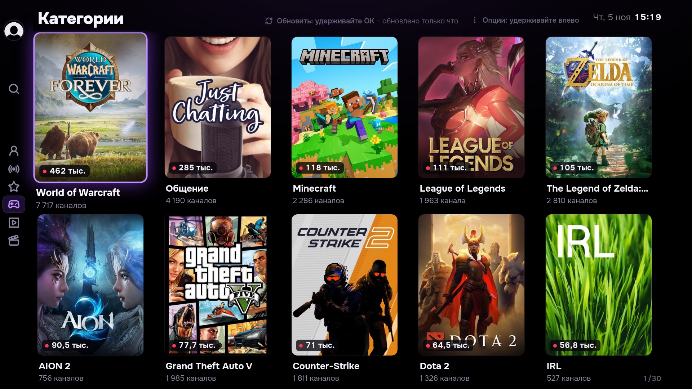
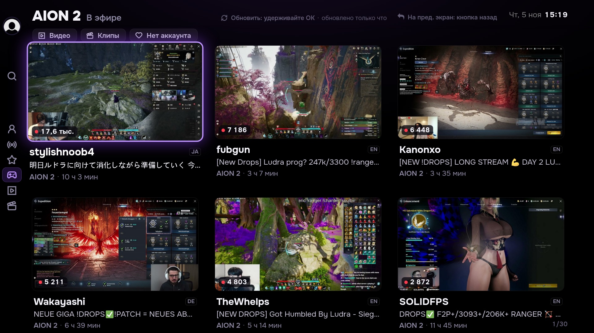
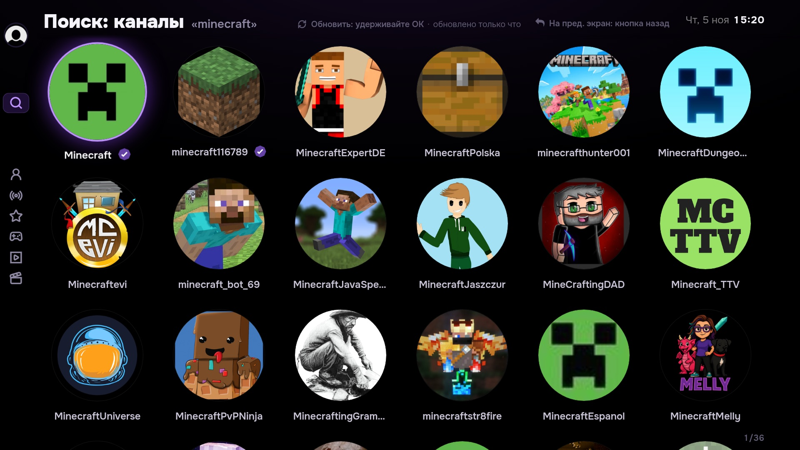
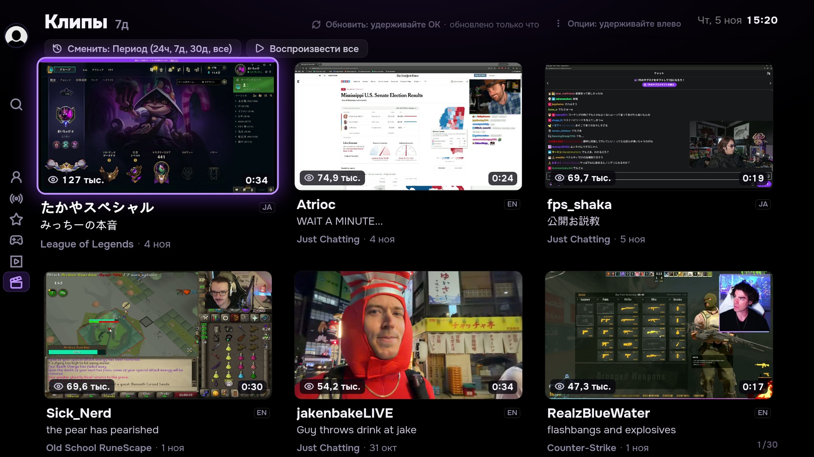
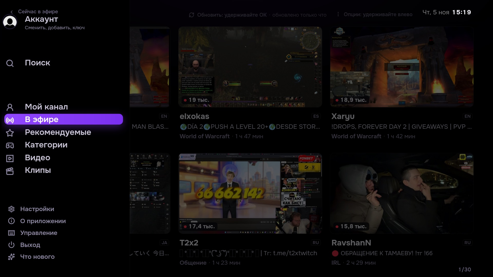
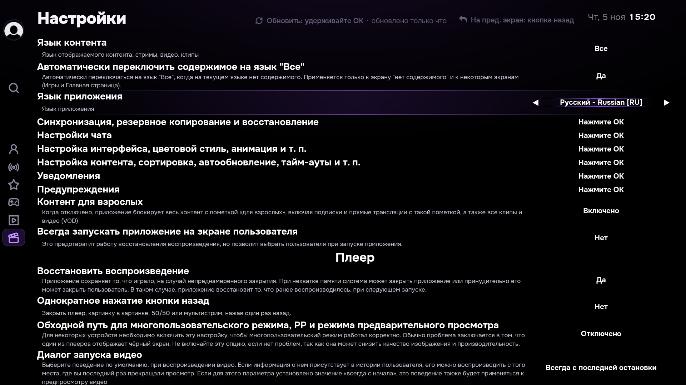
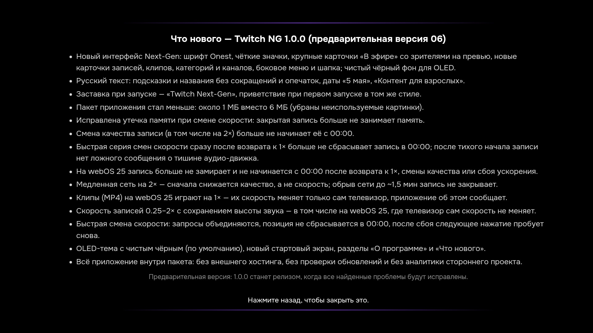

# Twitch NG

**Twitch NG (Next-Gen)** — независимое приложение Twitch для телевизоров LG на webOS. Оно устанавливается отдельно и может работать рядом со штатным приложением Twitch.

[English version](README.md) · [Релизы](https://github.com/emoorpheus/TwitchNG/releases) · [Сообщить о проблеме](https://github.com/emoorpheus/TwitchNG/issues)

История разработки и технические заметки сохранены в [инженерном журнале](docs/engineering-notes.ru.md).

## Скриншоты

Скриншоты показывают интерфейс сборки pre-release 06 и демонстрируют опубликованный дизайн. Карточки и список трансляций содержат динамические данные Twitch и могут отличаться от того, что отображается у вас.

| Главная и эфиры | Записи | Категории |
|---|---|---|
|  |  |  |

| Трансляции в категории | Поиск каналов | Клипы |
|---|---|---|
|  |  |  |

| Боковая навигация | Настройки | Что нового |
|---|---|---|
|  |  |  |

## Зачем Twitch NG на телевизоре?

- **Управление с пульта.** Крупные карточки, заметный фокус, постоянная боковая панель и читаемые подписи позволяют пользоваться приложением без мыши и клавиатуры.
- **Больше информации до запуска эфира.** В карточке трансляции вместе показаны зрители, язык, категория, заголовок и длительность эфира. В карточках записей видны продолжительность, просмотры, дата и прогресс просмотра.
- **Быстрый поиск подходящего контента.** Можно открывать рекомендации, эфиры каналов, искать каналы, переходить в игровую категорию и переключаться между трансляциями и хайлайтами.
- **Удобный темп просмотра VOD.** Для поддерживаемых путей воспроизведения VOD и клипов доступны скорости от 0,25× до 2× с сохранением высоты тона там, где это поддерживается.
- **Штатное приложение остаётся на месте.** У Twitch NG собственные имя приложения и данные. Оно устанавливается рядом со штатным Twitch и не заменяет его.
- **Комфортный тёмный экран.** Чёрный фон и аккуратные фиолетовые акценты рассчитаны на просмотр OLED в тёмной комнате. Если новый вид не подходит, интерфейс Next-Gen можно отключить.

> Twitch NG — независимый проект сообщества. Он не связан с Twitch Interactive, Inc. и не одобрен этой компанией.

## Возможности

- Просмотр Twitch, трансляций, записей эфиров (VOD) и клипов через интерфейс телевизора.
- Необязательный **интерфейс Next-Gen**: обновлённая типографика, фокусировка, бейджи и сведения о воспроизведении. Его можно отключить параметром `TWITCHNG_UI='0'`.
- Необязательная регулировка скорости VOD и клипов от **0,25× до 2×** с сохранением высоты тона. Для прямых трансляций управление скоростью не показывается.
- Визуальный режим для OLED-экранов и отдельный экран About.
- Свой профиль приложения и отдельный вход, не связанный со штатным Twitch.

Для изменения скорости используется встроенный движок **STTV Speed**. У приложения и движка независимая нумерация версий.

## Элементы интерфейса

Приложение сохраняет привычную навигацию Twitch и адаптирует отображение для телевизора. Названия ниже приведены по текущему английскому интерфейсу; конкретные разделы зависят от аккаунта и данных, которые возвращает Twitch.

### Главная, рекомендации и прямые трансляции

- **Рекомендуемое / Главная** помогает находить контент: доступные ряды Twitch собраны на одном экране, рядом остаётся боковая панель навигации.
- **В эфире** показывает карточки трансляций. На превью крупно указано число зрителей, а рядом с карточкой — канал, название трансляции, игра или категория, язык и длительность эфира. Можно сравнить эфиры, не открывая каждый из них.
- **Фокус и навигация** помогают следить за выбранной карточкой с дивана: она приподнимается и получает заметную рамку. В оформлении Next-Gen используются шрифт Onest, контурные значки Lucide, чёрный OLED-фон и фиолетовые акценты.
- **Подписки и результаты поиска** используют ту же структуру карточек, поэтому канал и сведения о трансляции расположены одинаково в разных разделах.
- Над рядом могут отображаться переключатели периода, **Трансляции / Хайлайты** и **Воспроизвести всё**. Доступные действия зависят от экрана.

### Категории и каналы

- **Категории** отображаются с вертикальными постерами. На постере показано число зрителей, под названием — число каналов. До перехода в категорию видно и её популярность, и количество авторов в эфире.
- **Поиск каналов** показывает круглые аватары и названия по центру — так проще отличать авторов от игровых постеров. Переход на канал открывает доступные трансляции, записи или клипы.
- **Страницы каналов** и разделы аккаунта требуют входа в Twitch. Их содержимое предоставляет Twitch, и оно может меняться независимо от приложения.

### Записи и клипы

- **Записи трансляций (VOD)** показывают превью, длительность, число просмотров, категорию и дату. Если Twitch предоставляет данные, полоса на превью отмечает уже просмотренный фрагмент. Длительность и просмотры видны прямо на изображении, а заголовок и канал остаются отдельными строками под ним.
- **Клипы** имеют отдельные превью и экран воспроизведения. Управление скоростью доступно, только если плеер телевизора применяет выбранную скорость; некоторые клипы могут остаться на обычной скорости.
- Переключатель скорости показывается для VOD и клипов, но не для прямых эфиров. Доступны значения **0,25×, 0,5×, 0,75×, 1×, 1,25×, 1,5× и 2×**. На поддерживаемых путях движок старается сохранять высоту тона. Некоторые пути плеера Twitch или webOS могут игнорировать скорость либо долго возвращать обычное воспроизведение.
- Качество воспроизведения выбирается средствами плеера. При смене качества позиция VOD должна сохраняться, однако в текущей предварительной версии восстановление иногда задерживается; подробности приведены выше.

### Навигация, настройки и сведения о приложении

- **Боковое меню и шапка** дают доступ к разделам, показывают заголовок выбранного раздела, часы и время последнего обновления, если оно доступно. Текущий пункт меню выделяется для навигации пультом.
- **Настройки** используют шрифт и оформление фокуса Next-Gen. Настройки и управляющие элементы SmartTwitchTV сохраняются; описания выделены вторичным цветом.
- **О приложении (About)** показывает название Twitch NG, номер предварительной версии, версию движка скорости и версию webOS, сообщённую телевизором. Здесь также приведены лицензия и уведомление о товарном знаке.
- **Что нового** перечисляет изменения установленной предварительной версии. При первом запуске может появиться приветственное окно; нажмите OK или «Назад», чтобы закрыть его.

Типографика, значки, фокус и отступы оформлены единообразно в меню, сетках контента, диалогах, настройках, разделе About и экране новостей. Благодаря этому приложение выглядит цельно во всех разделах.

### Настройки внешнего вида

OLED-пресет и интерфейс Next-Gen включены по умолчанию. Ниже — диагностические переключатели для опытных пользователей, а не обычные пункты меню приложения:

| Параметр | Действие | Как вернуть значение по умолчанию |
|---|---|---|
| `localStorage.TWITCHNG_OLED = '0'` | Выключает OLED-пресет и вместе с ним интерфейс Next-Gen. | Удалить ключ или присвоить `null`. |
| `localStorage.TWITCHNG_UI = '0'` | Выключает интерфейс Next-Gen, оставляя OLED-пресет. После изменения перезапустите приложение. | Удалить ключ или присвоить `null`, затем перезапустить приложение. |

Эти параметры задаются через веб-инспектор приложения. Их не нужно вводить в поиске Twitch или обычных настройках телевизора.

## Совместимость и текущее состояние

Текущая предварительная версия — **Twitch NG 1.0.0 pre-release 06** с движком **STTV Speed 1.3.8**. Установленный пакет проверили на телевизоре LG с webOS 25. В VOD наблюдалась работа скоростей 1,5× и 2×; качество звука в этом прогоне не оценивали.

Известные ограничения по результатам проверки:

- Интерфейс Next-Gen снизил измеренную частоту навигации по фокусу примерно с 55–56 до 35–40 кадров/с. При отключении интерфейса показатели вернулись к исходным.
- Возврат с 1,5× на 1× иногда занимал 19–35 секунд, пока плеер восстанавливал воспроизведение. На результат может влиять буферизация сети.
- Сценарии входа, некоторые проверки звука, роутера и длительных сессий ещё не проверены.

Это предварительная версия. Результат может зависеть от версии webOS, сети и изменений в Twitch. Актуальные сборки и примечания публикуются на странице [релизов](https://github.com/emoorpheus/TwitchNG/releases).

## Установка

1. Откройте страницу [релизов](https://github.com/emoorpheus/TwitchNG/releases) и скачайте установочный файл Twitch NG `.ipk`.
2. Установите пакет подходящим для вас способом разработки или sideloading для webOS.
3. Запустите **Twitch NG** с главного экрана телевизора и войдите в аккаунт. Сессия входа отдельна от штатного приложения.

Пакет предназначен для телевизоров LG на webOS. Для установки может потребоваться Developer Mode или другой инструмент sideloading. Скрипты из `deploy/` изменяют установленный SmartTwitchTV и рассчитаны на опытных пользователей; для установки отдельного приложения Twitch NG они не нужны.

## Сообщить о проблеме

Сначала проверьте [существующие обращения](https://github.com/emoorpheus/TwitchNG/issues). В новом обращении укажите версию приложения и STTV Speed, основную версию webOS, шаги для повторения и относящиеся к проблеме сообщения об ошибках. Не публикуйте пароли, cookies, токены, IP-адреса и неотредактированные диагностические дампы.

## Приватность и безопасность

Для работы Twitch NG обращается к сервисам Twitch, включая вход и получение контента. При активном режиме MSE движок скорости может использовать настроенный в проекте путь получения медиаданных. Подробности потоков данных и модели безопасности описаны в [SECURITY.md](SECURITY.md). О проблемах безопасности сообщайте приватным способом, указанным там.

## Благодарности и лицензия

Twitch NG основан на открытом проекте SmartTwitchTV и его порте для webOS. Движок изменения скорости развивается в этом репозитории. Сведения о компонентах и лицензиях приведены в заголовках исходников и [SECURITY.md](SECURITY.md). Проект распространяется по GPL-3.0; сторонние компоненты сохраняют собственные лицензии.
