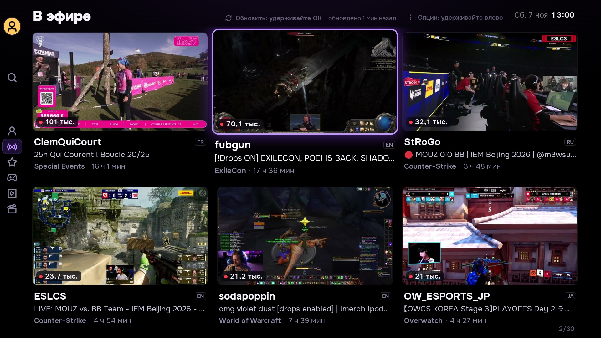
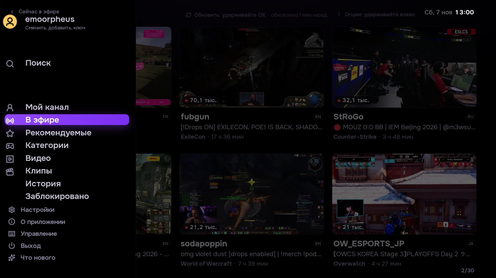
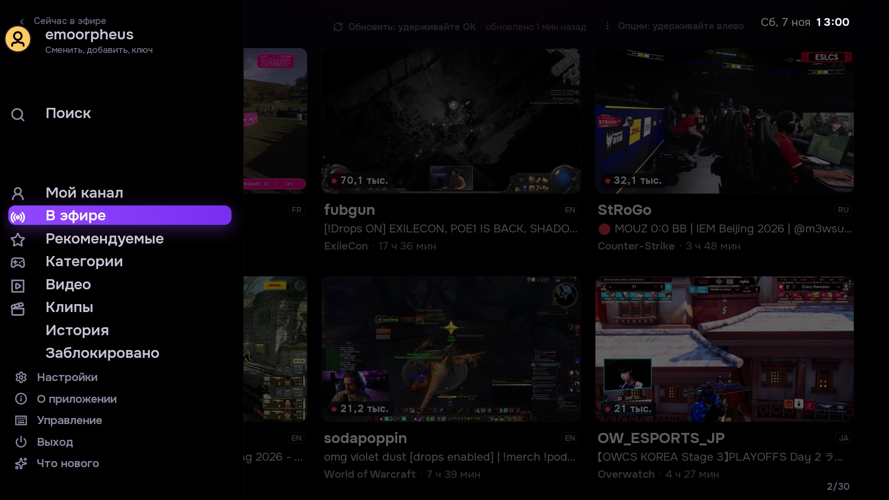
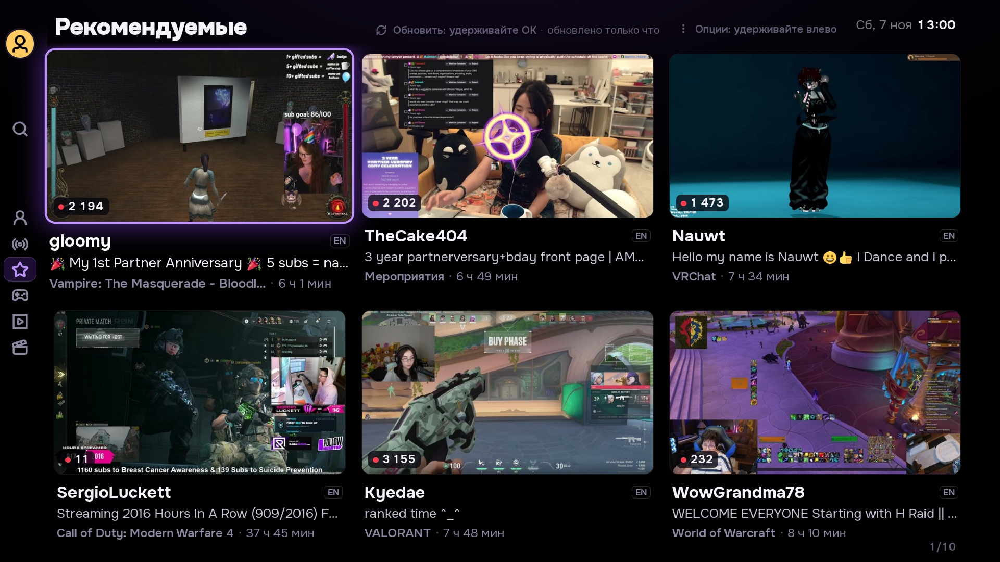
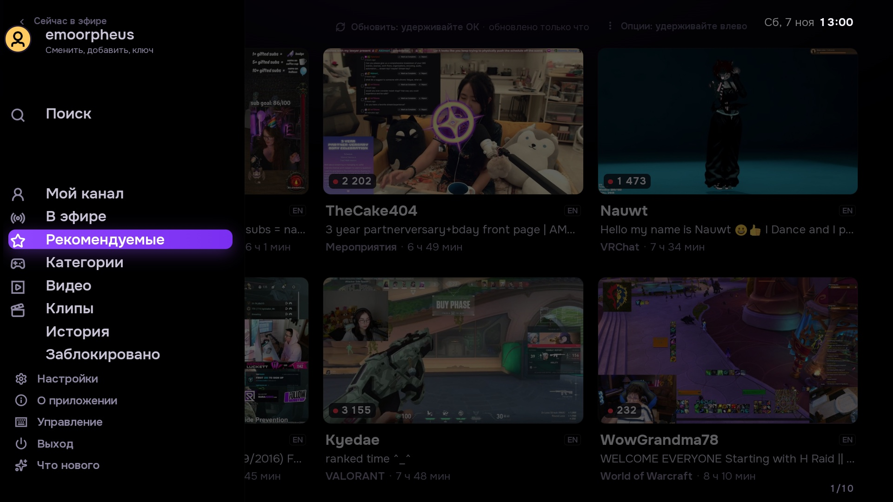
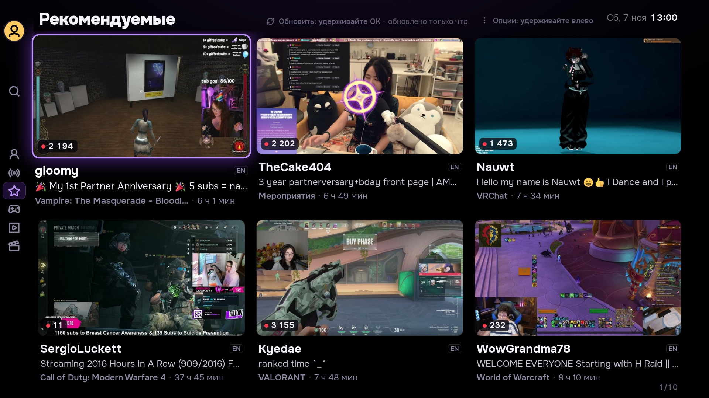
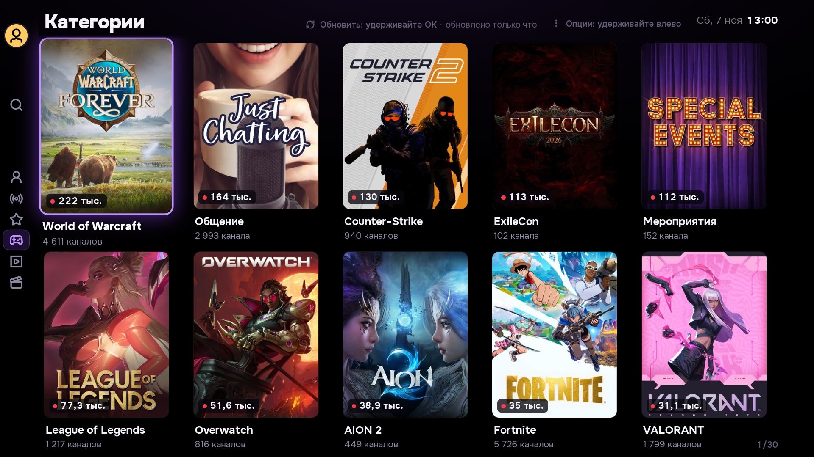
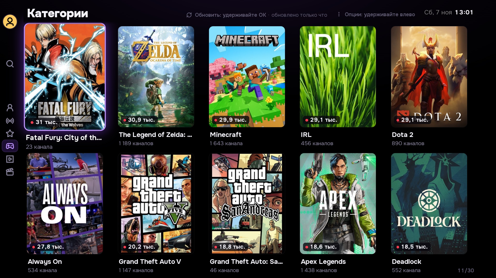
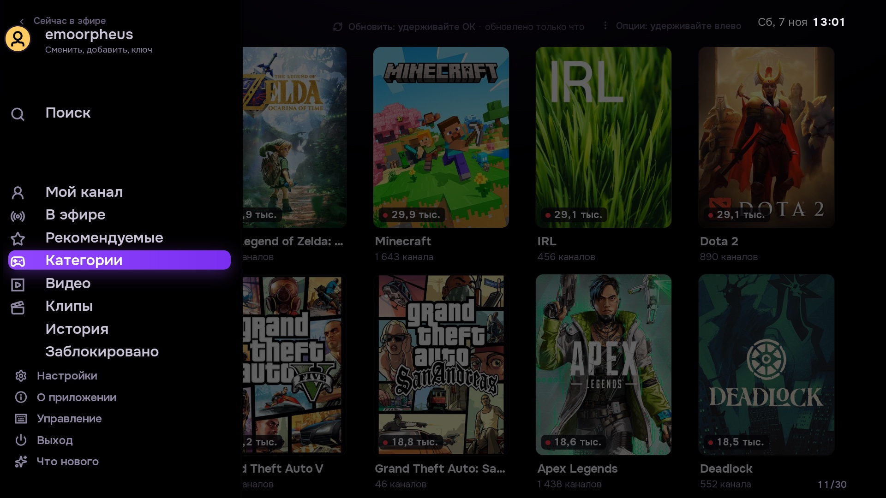
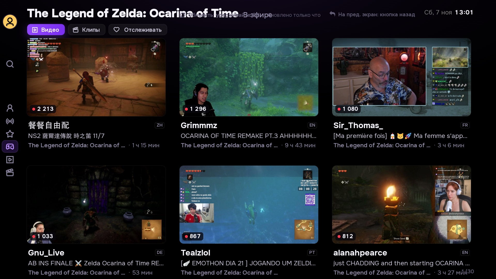

<p align="center">
  
</p>

<h1 align="center">Twitch Next-Gen для LG webOS</h1>

<p align="center">
  <b>Современный, быстрый клиент Twitch без рекламы для смарт-телевизоров LG webOS</b><br>
  С сохранением высоты тона звука при скорости 0.25–2× на VOD, шрифтом Onest, плавным интерфейсом 52.4 FPS и режимом True Black OLED.
</p>

<p align="center">
  <a href="https://github.com/emoorpheus/TwitchNG/releases/latest"></a>
  
  <a href="LICENSE"></a>
  
</p>

<p align="center">
  <a href="README.md"><b>🇬🇧 Read documentation in English</b></a>
</p>

---

## 🌟 О проекте

**Twitch Next-Gen (Twitch NG)** — отдельное независимое приложение Twitch, разработанное специально для телевизоров LG на платформе webOS. Оно устанавливается под собственным идентификатором (`com.twitchng.tv`), сосуществует рядом со штатным клиентом Twitch из магазина LG и не перезаписывает его.

Twitch NG объединяет возможности десктопного просмотра Twitch и комфорт гостиной: просмотр записей трансляций (VOD) с ускорением от 0.25× до 2× без изменения высоты голоса, переработанный интерфейс Next-Gen с чёткой типографикой **Onest** и векторными значками **Lucide**, мгновенный возврат к скорости 1× без зависания аппаратного декодера и специальную тему True Black, созданную для экранов OLED.

<p align="center">
  
  <br>
  <i>Главный экран в режиме OLED: идеальный чёрный фон (#000000), подробная информация о стримах и чёткая типографика Onest</i>
</p>

---

## ✨ Основные возможности

- 🎮 **Интерфейс под пульт Magic Remote**: крупные информативные карточки, фиолетовая подсветка активного элемента, удобное боковое меню и плавность перемещения фокуса **52.4 FPS** на реальном телевизоре.
- ⚡ **Ускорение записей VOD (0.25× – 2×) с сохранением тона**: встроенный движок **STTV Speed 1.3.9** меняет темп без эффекта «мультяшного голоса» (алгоритм WSOLA) на скоростях 0.25×, 0.5×, 0.75×, 1×, 1.25×, 1.5× и 2×. Регулировка скорости отображается только на VOD и не загромождает прямой эфир.
- 🔄 **Мгновенный возврат к 1×**: переключение со скорости обратно на 1× происходит сразу, без зависаний декодера на 10–24 секунды и чёрных экранов.
- 📈 **Автоматическое восстановление качества**: при кратковременных просадках домашней сети плеер временно снижает качество, а затем сам возвращает максимальное разрешение, как только связь стабилизируется.
- 🌑 **Режим «Истинный чёрный» (OLED Mode)**: замена тёмно-серых подложек на чистый чёрный цвет `#000000` в сетке, плеере и меню для максимального контраста без паразитного свечения пикселей.
- 🎬 **Современный плеер (Stage 3)**:
  - Минималистичная круглая кнопка Play/Pause с мягким фиолетовым свечением.
  - Аккуратная градиентная полоса перемотки с точной отметкой конца 100%.
  - Асимметричный ограничитель, исключающий вылет полосы влево при перемотке в начало.
  - Многослойные тени таймкодов для лёгкой читаемости на фоне ярких игровых сцен.
  - Панель управления приподнята по оси Z над полупрозрачным чатом.
- 💬 **Встроенный чат и контекст канала**: количество зрителей онлайн, время с начала эфира, языковые метки, категории и окно чата без перекрытия ключевых зон экрана.
- 🔍 **Удобный поиск и навигация**: рекомендации, отслеживаемые каналы, каталог игр и категорий, быстрый поиск стримеров и библиотека клипов.
- 🎛️ **Два полноценных языка**: интерфейс изначально разработан на **русском** и **английском** языках с автоматическим определением и ручным переключением в настройках.
- 🛡️ **Приватность и отсутствие рекламы**: полностью чистый просмотр без сторонней аналитики и телеметрии. Данные авторизации хранятся изолированно на вашем ТВ.

---

## 📸 Скриншоты интерфейса

Скриншоты демонстрируют интерфейс официального релиза Twitch NG 1.0.0, сделанный напрямую на экране телевизора LG OLED в разрешении 1080p. Все карточки, каналы и превью отражают реальную трансляцию данных Twitch.

<table align="center" width="100%">
  <tr>
    <td width="50%" align="center"><b>Главный экран: прямой эфир</b></td>
    <td width="50%" align="center"><b>Боковое меню навигации</b></td>
  </tr>
  <tr>
    <td align="center"></td>
    <td align="center"></td>
  </tr>
  <tr>
    <td align="center"><i>Стримы с числом зрителей, тегами игры, названием эфира и временем онлайн</i></td>
    <td align="center"><i>Быстрый доступ к поиску, категориям, записям, клипам, настройкам и профилю</i></td>
  </tr>
  <tr>
    <td width="50%" align="center"><b>Категории и игры</b></td>
    <td width="50%" align="center"><b>Стримы по выбранной игре</b></td>
  </tr>
  <tr>
    <td align="center"></td>
    <td align="center"></td>
  </tr>
  <tr>
    <td align="center"><i>Каталог игровых и творческих разделов с количеством зрителей онлайн</i></td>
    <td align="center"><i>Трансляции внутри выбранного игрового раздела</i></td>
  </tr>
  <tr>
    <td width="50%" align="center"><b>Записи трансляций (VOD)</b></td>
    <td width="50%" align="center"><b>Популярные клипы</b></td>
  </tr>
  <tr>
    <td align="center"></td>
    <td align="center"></td>
  </tr>
  <tr>
    <td align="center"><i>Прошедшие эфиры с длительностью, прогрессом просмотра и датой</i></td>
    <td align="center"><i>Лучшие клипы с фильтрацией по дням, неделям и за всё время</i></td>
  </tr>
  <tr>
    <td width="50%" align="center"><b>Поиск каналов</b></td>
    <td width="50%" align="center"><b>Экран настроек</b></td>
  </tr>
  <tr>
    <td align="center"></td>
    <td align="center"></td>
  </tr>
  <tr>
    <td align="center"><i>Быстрый поиск стримеров с круглыми аватарами и статусом партнёра</i></td>
    <td align="center"><i>Настройки под пульт: фиолетовые кольца фокуса, тест звука и выбор языка</i></td>
  </tr>
  <tr>
    <td width="50%" align="center"><b>Окно «Что нового»</b></td>
    <td width="50%" align="center"><b>Плеер и панель управления (Stage 3)</b></td>
  </tr>
  <tr>
    <td align="center"></td>
    <td align="center"></td>
  </tr>
  <tr>
    <td align="center"><i>Список изменений и новых функций релиза прямо на экране ТВ</i></td>
    <td align="center"><i>Плеер Stage 3 с кнопками по центру, градиентной полосой и живым чатом</i></td>
  </tr>
</table>

---

## 📦 Какой пакет выбрать для установки

| Файл пакета | Поддерживаемая webOS | Архитектура | Размер |
|---|---|---|---|
| **`com.twitchng.tv_1.0.0_all.ipk`** | **webOS 3.0+ \| 22+ \| 24+ \| 25+** | Универсальный (любые смарт-ТВ LG) | **~1.2 МБ** *(Автономный клиент)* |

---

## 🚀 Установка на телевизор

Телевизор должен быть переведён в **Режим разработчика (Developer Mode)** или иметь **Root** (например, через [webosbrew.org](https://webosbrew.org)).

### Способ 1: webOS Dev Manager (рекомендуется)
1. Скачайте файл `com.twitchng.tv_1.0.0_all.ipk` со страницы [Releases](https://github.com/emoorpheus/TwitchNG/releases).
2. Запустите [webOS Dev Manager](https://github.com/webosbrew/dev-manager-desktop) на компьютере.
3. Нажмите кнопку **Install...**, выберите файл `.ipk` и дождитесь уведомления об успешной установке.

### Способ 2: Через консоль webOS CLI (ares-cli)
```bash
ares-install -d tv com.twitchng.tv_1.0.0_all.ipk
ares-launch -d tv com.twitchng.tv
```

### Способ 3: Для ТВ с Root-доступом по SSH
```bash
scp com.twitchng.tv_1.0.0_all.ipk root@$TV_HOST:/tmp/com.twitchng.tv.ipk
ssh root@$TV_HOST 'luna-send -n 1 luna://com.webos.appInstallService/dev/install "{\"id\":\"com.twitchng.tv\",\"ipkUrl\":\"/tmp/com.twitchng.tv.ipk\",\"subscribe\":false}"'
```

*Для удаления приложения:* `ares-install -d tv -r com.twitchng.tv`

---

## 🎮 Управление с пульта Magic Remote

| Кнопка | Действие |
|---|---|
| **Стрелки (D-Pad)** | Навигация по карточкам стримов, меню, категориям и настройкам с чётким кольцом фокуса |
| **OK / Enter** | Открытие выбранного стрима, канала, игры или переключение опции |
| **Назад (Back)** | Возврат к предыдущему экрану / Открытие бокового меню / Закрытие диалога |
| **Вверх (в плеере)** | Показ панели управления плеером, полосы прогресса, данных канала и чата |
| **Вниз (в плеере)** | Скрытие панели плеера / Быстрый доступ к опциям воспроизведения |
| **Влево / Вправо (в плеере)** | Перемотка назад / вперёд в записях VOD (с мгновенным возобновлением темпа) |
| **Play / Pause** | Воспроизведение и пауза |
| **Удержание OK** | Принудительное обновление текущей ленты стримов или списка категорий |
| **Удержание Влево** | Меню дополнительных настроек отображения миниатюр и сетки |

---

## 🌍 Язык интерфейса

Twitch Next-Gen полностью переведён на **русский** и **английский** языки:
- При первом запуске язык телевизора определяется автоматически.
- Чтобы сменить язык вручную:
  1. Откройте боковое меню и перейдите в **«Настройки»** (⚙️).
  2. Выберите пункт **«Язык»** (`app_lang`).
  3. Переключите на **Русский [RU]** или **English [EN]**. Интерфейс обновится мгновенно.

---

## 🛠️ Сборка из исходного кода

**Требования:** Node.js 22+, npm.

```bash
# Клонирование репозитория
git clone https://github.com/emoorpheus/TwitchNG.git
cd TwitchNG

# Запуск тестов качества и проверки гигиены репозитория
node tests/hygiene.mjs

# Сборка универсального пакета в dist/
node build/build-app.mjs
```

Собранный установочный файл появится в каталоге `dist/`:
- `dist/com.twitchng.tv_1.0.0_all.ipk`

---

## 💡 Полезная информация

- **Изолированная сессия**: приложение хранит ключи авторизации и локальные параметры отдельно от оригинального клиента Twitch. Вход выполняется по QR-коду или короткому коду с телефона/ПК.
- **Собственный идентификатор**: зарегистрировано как `com.twitchng.tv` — никогда не конфликтует со стандартным приложением и не блокируется магазином LG.
- **Безопасность и приватность**: Twitch NG обращается исключительно к официальным публичным серверам Twitch (GraphQL, Usher, HLS). Никакой телеметрии, слежки или сторонних запросов.

---

## 📜 Авторы, благодарности и лицензия

- Распространяется под лицензией **GPL-3.0-only**. См. [LICENSE](LICENSE).
- Форк и развитие проекта [SmartTwitchTV](https://github.com/fgl27/SmartTwitchTV) от fgl27, с доработками TBSniller.
- Проектирование, новый визуальный стиль Next-Gen, звуковой движок STTV Speed 1.3.9 и адаптация под webOS 24/25 созданы в совместной разработке **emoorpheus** с нейросетевыми моделями **Anthropic Claude 3.7 / Opus 5.5**, **Google Gemini 3.8 Flash** и **Luna 6**.
- *Примечание:* «Twitch» является зарегистрированным товарным знаком Twitch Interactive, Inc. Данный проект является независимой разработкой с открытым исходным кодом и не связан с Twitch Interactive, Inc. или LG Electronics.
